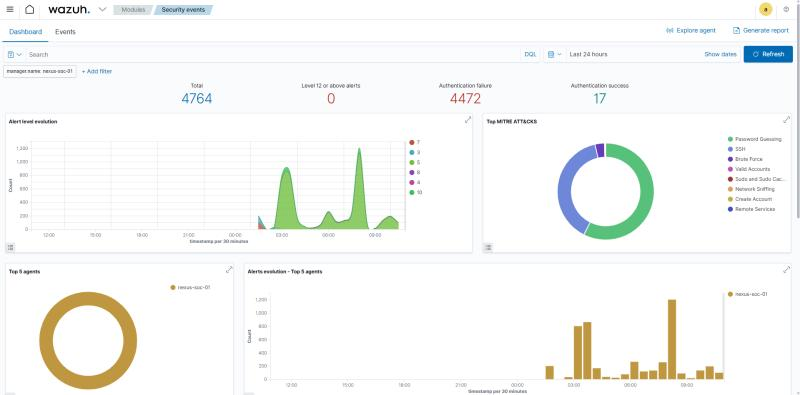
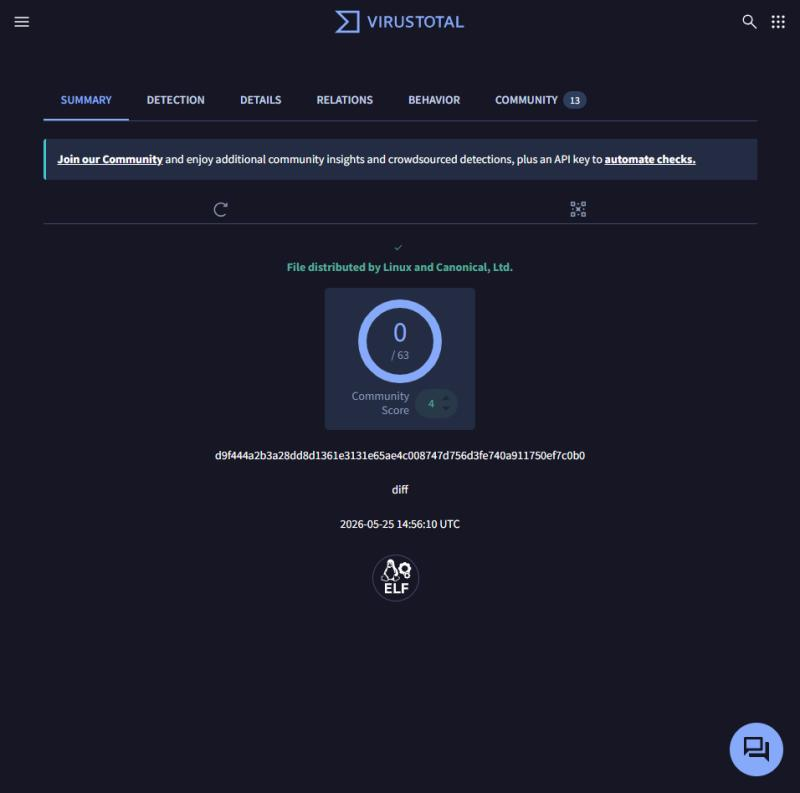
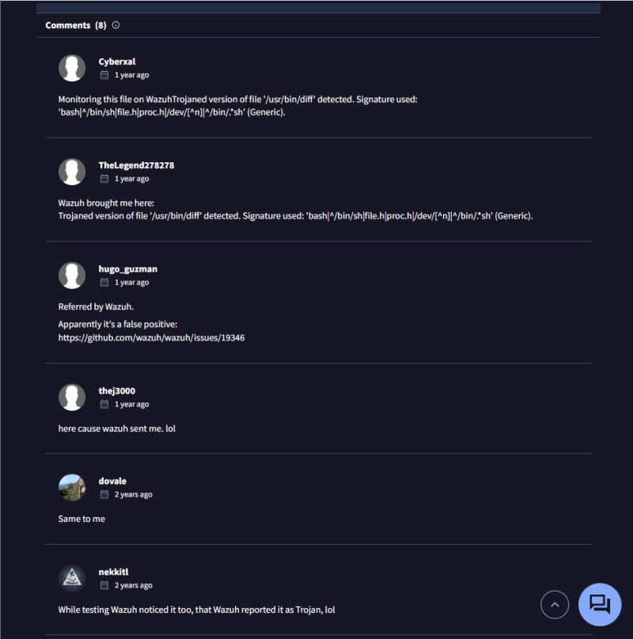
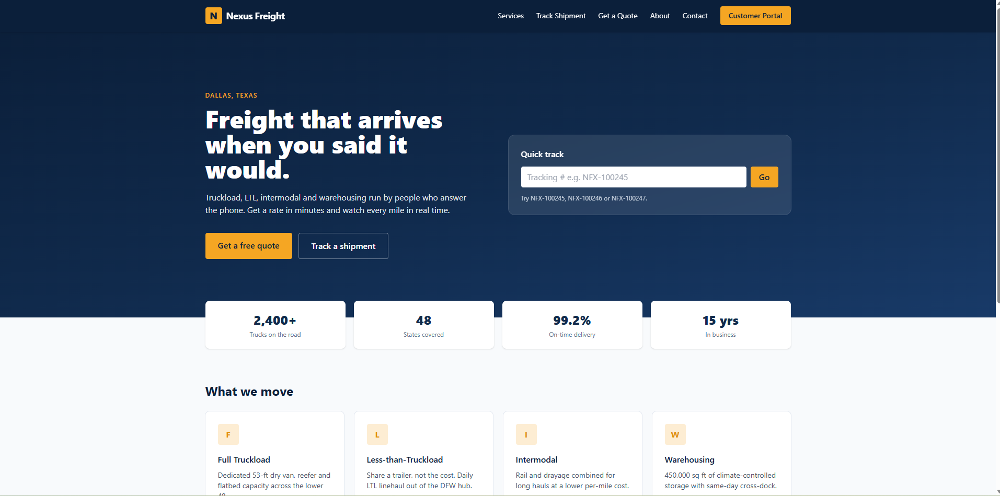
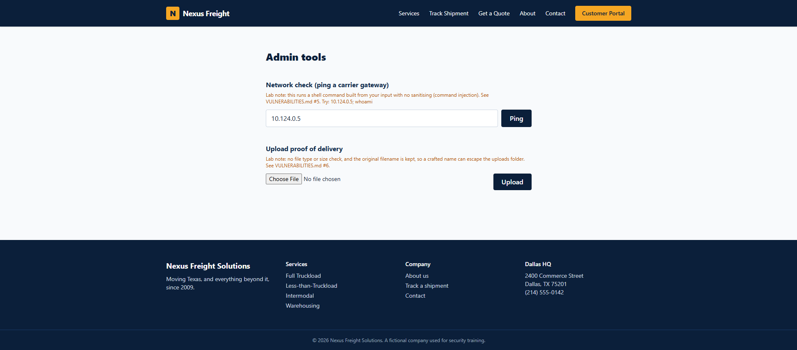
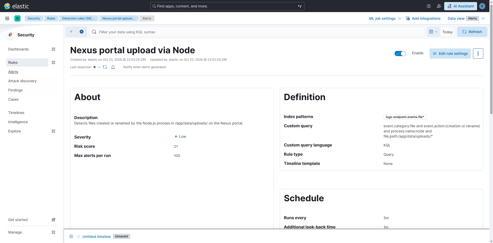
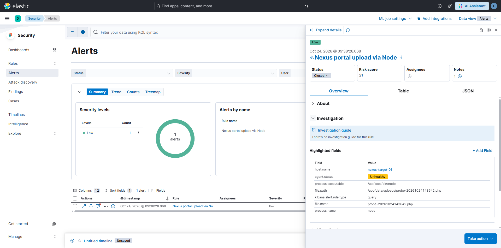

# Nexus Freight SOC Lab: Built, Hacked, Rebuilt Better

One lab, one story in three chapters. A cloud SOC lab built around a
fictional Dallas freight company, compromised by a real botnet, and rebuilt
with the architecture lessons that attack taught.

## Chapter 1: Built (Wazuh era, from Jun 2026)

- Cloud SOC on DigitalOcean, built around Wazuh SIEM/XDR, monitoring a
  fictional freight company, Nexus Freight Solutions.
- Within 2 hours of going live: 34 unique IP addresses and thousands of
  failed logins against default usernames like root, ubuntu, and postgres.
- Threat hunted the brute-force campaigns, confirmed no breach through log
  analysis, and hardened: Fail2Ban, IP allowlisting, SSH key enforcement.
- Built the Alert Investigation Framework: Categorize, Verify, Respond,
  Document. Field-tested on a live alert: Wazuh rule 510 flagged
  /usr/bin/diff as trojaned (level 7). Three verification checks (package
  logs, local integrity check, VirusTotal 0/63) proved it a false positive
  from an overly broad rootcheck signature.

## Chapter 2: Hacked

- During a simulation, SSH (port 22) was temporarily opened to the public
  internet with password authentication re-enabled, to simulate an attacker
  login.
- An automated bot found the open port almost instantly, brute-forced a weak
  secondary account with sudo privileges, installed DDoS malware, and turned
  the server into a weapon.
- DigitalOcean detected the server generating about 91,000 packets per second
  against an external target and isolated it.
- Two lessons. The attack landed while a separate false positive was being
  investigated: human distraction creates a window of opportunity. And the
  deeper one: everything lived on one server, so one breach took out both the
  victim and the witness.

## Chapter 3: Rebuilt better (Elastic era, from Oct 2026)

- Split into two servers. The target and the SIEM now live on separate
  machines, talking over a private network. Compromising the app no longer
  means compromising the monitoring.
- New SIEM: Elastic Security, with nearly 2,000 prebuilt detection rules
  installed.
- A real front door: the app sits behind an Nginx reverse proxy with a
  ModSecurity WAF, plus Suricata watching the traffic. HTTPS everywhere, and
  the old open test port closed for good.
- SSH locked down: key-only auth, no passwords, access restricted to one IP.
- A custom app instead of an off-the-shelf vulnerable one, with six
  deliberate vulnerabilities to practice against: SQL injection, broken
  access control, stored XSS, weak sessions, command injection, and unsafe
  file upload.
- Proof it works: a prebuilt file-upload rule did not fire on the app because
  it was written for PHP/Apache stacks and this app runs on Node.js. So a
  custom rule was written for it ("Nexus portal upload via Node", Low
  severity, risk 21, 5-minute schedule). A test upload fired the first alert,
  and it was triaged end to end: true positive, authorized test, closed with
  a documented verdict.

The lesson from both labs: your monitoring has to survive the incident it is
supposed to detect.

## Current lab environment

- Target: custom Next.js freight site plus customer portal in Docker, behind
  Nginx/ModSecurity WAF, Suricata, and Elastic Agent.
- SIEM: Elasticsearch, Kibana, and Fleet.
- Cost: about $70/month in cloud hosting.
- Nexus Freight Solutions is a fictional company used for security training.

## Standards (carried over from the old repo)

- Screenshots are evidence, annotated with what each one proves.
- Only what is actually built and validated gets claimed.
- Sanitized: no passwords, keys, tokens, or real public IPs, ever.
